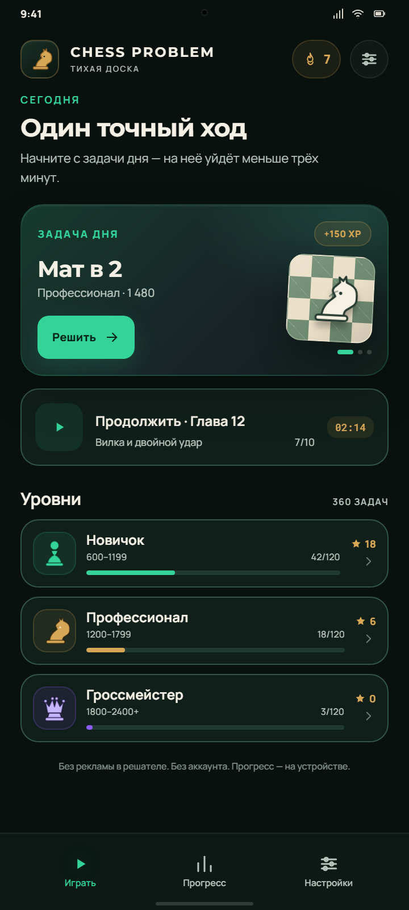
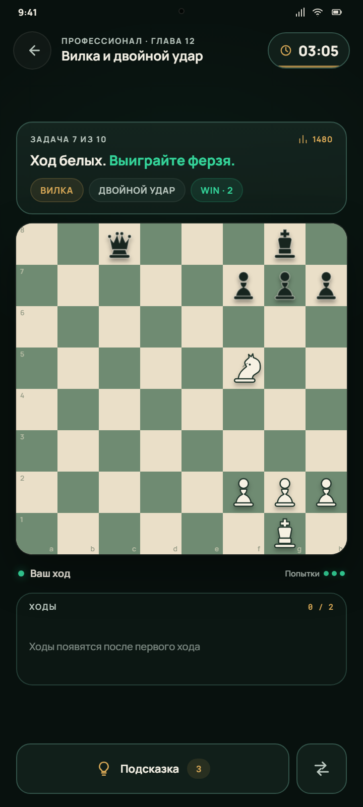
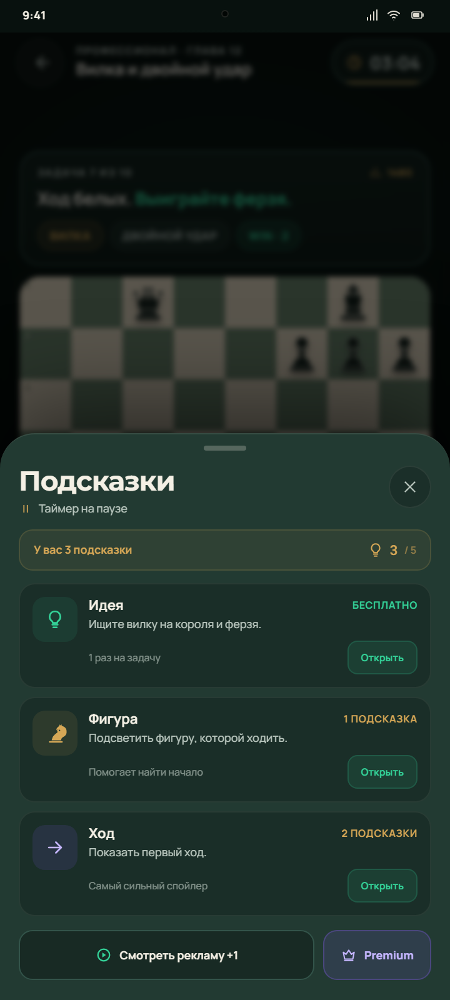
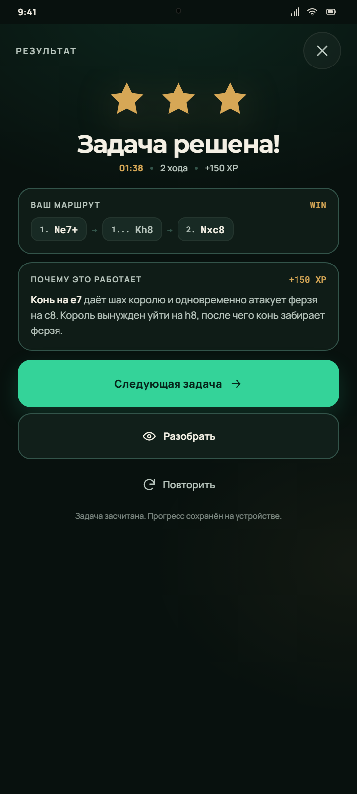
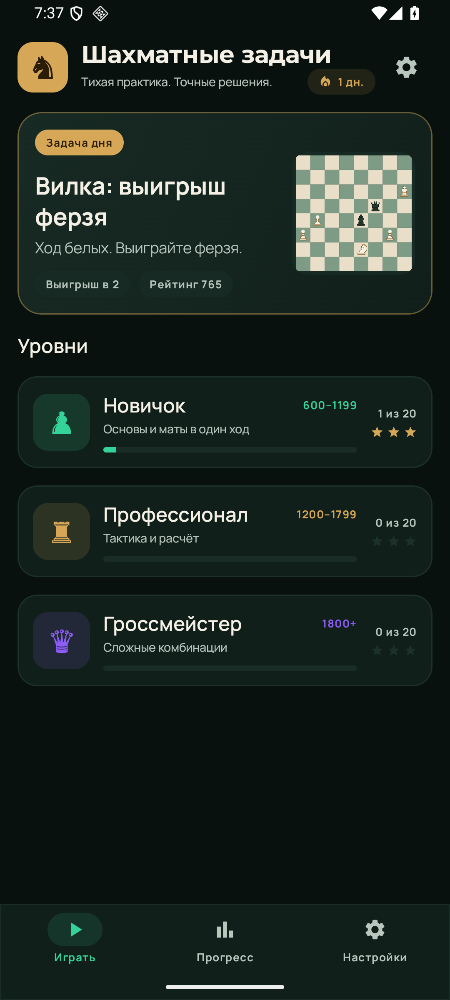
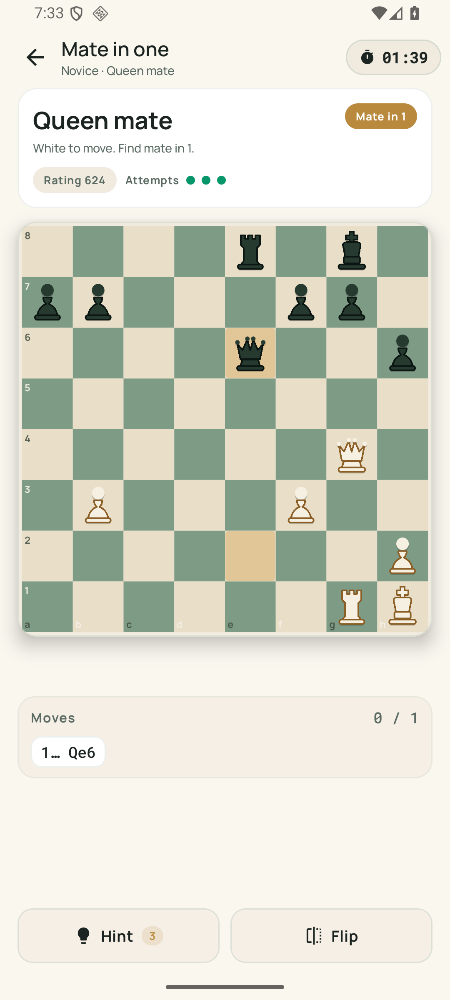
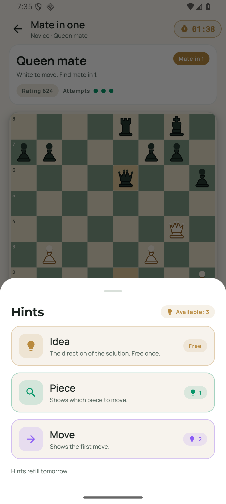
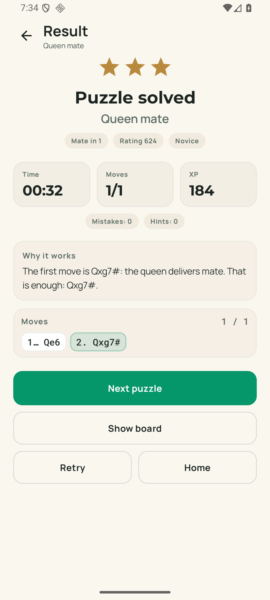

# Chess Problem

> **Одна задача. Одна минута. Один точный ход.**
> Тренажёр шахматных задач для Android: 360 реальных позиций, три уровня,
> таймер и подсказки, которые учат думать, а не угадывать.

[](https://github.com/iilmchat/chess-problem/actions/workflows/ci.yml)
[](docs/CHANGELOG.md)
[](docs/development/ARCHITECTURE.md)
[](docs/design/UI_UX_SPEC.md)
[](docs/development/RUSTORE.md)
[](#лицензия)

**Версия:** `v0.2.1-60-puzzles` · **Фаза:** Android vertical slice + контент
**Стек:** Kotlin 2.2.10 · Jetpack Compose · Material 3 · chesslib
**Платформа:** Android 8.0+ (minSdk 26), compileSdk 37 / targetSdk 36
**Локализация:** RU · EN
**Сеть:** офлайн, без аккаунта и сбора персональных данных
**© 2026 RuChating (iilmchat)**

> **Статус:** Android-проект собирается и запускается. Реализованы доска,
> решатель, подсказки, таймер, пауза, продолжение, звёзды/XP, Room-прогресс,
> настройки, RU/EN и **60 production-задач** (20 на уровень, 2 главы).
> Полные 360 задач, drag-and-drop, TalkBack-навигация по доске, Premium и
> rewarded-реклама — следующие этапы.

---

## Прототип

Четыре экрана, RU/EN, таймер, подсказки и продолжение — в одном HTML-файле:
[`design/prototype/index.html`](design/prototype/index.html).
Как открыть и что проверять — в [README прототипа](design/prototype/README.md).

| Главная | Решатель |
| --- | --- |
| [](design/prototype/screenshots/home-360.png) | [](design/prototype/screenshots/solver-360.png) |

| Подсказки | Результат |
| --- | --- |
| [](design/prototype/screenshots/hints-360.png) | [](design/prototype/screenshots/result-360.png) |

## Android vertical slice

Debug-сборка на эмуляторе Pixel 6 (Android 16, 1080×2400). Больше снимков и
чек-лист проверки — в [docs/screenshots/android](docs/screenshots/android/README.md).

| Главная | Решатель |
| --- | --- |
| [](docs/screenshots/android/home-dark-ru.png) | [](docs/screenshots/android/puzzle-light-en.png) |

| Подсказки | Результат |
| --- | --- |
| [](docs/screenshots/android/hints-light-en.png) | [](docs/screenshots/android/result-solved-light-en.png) |

---

## Что это

**Chess Problem** — мобильный тренажёр шахматных задач. На экране — доска с
реальной игровой позицией, задание («мат в два», «выиграйте ферзя», «сделайте
ничью») и таймер. Игрок рассчитывает вариант, делает ходы, получает звёзды и
короткий разбор. Следующая задача — сразу, без энергии, жизней и навязанной
рекламы.

```text
Выбрать уровень → прочитать задание → решить на доске → разбор → следующая задача
                                      ↑                    ↓
                                 подсказки          звёзды, XP, серия
```

Проект сознательно повторяет лучшие стороны шахматных тренажёров — понятную
градацию сложности, темы, таймер и статистику — и убирает то, что мешает
учиться: платные жизни, агрессивные интерстишлы и «бесконечные» подсказки,
которые просто показывают ответ.

**Обещание игроку:** «У меня есть пять минут и одна задача. Я могу подумать,
ошибиться и понять, почему ход работает».

---

## Возможности

### 🧩 Контент

- **360 задач к релизу v1.0:** 3 уровня × 12 глав × 10 задач.
- **Три уровня:** Новичок (рейтинг 600–1199), Профессионал (1200–1799),
  Гроссмейстер (1800–2400+).
- **Реальные позиции:** основа — открытая база задач Lichess (CC0 1.0),
  дополненная авторскими позициями; линии проверяются автоматически,
  тексты и подсказки — выборочно вручную (KI-017).
- **Темы:** мат в 1/2/3, вилка, связка, отвлечение, завлечение, перекрытие,
  рентген, промежуточный ход, превращение, цугцванг, крепость, этюдные идеи.
- **Разбор:** короткое объяснение идеи на RU и EN, а не только «правильный ход».
- **Задача дня:** одна позиция на всех, локально, без сервера.

### ⏱ Режим решения

- **Задание и таймер:** время зависит от рейтинга задачи и числа ходов.
- **Три попытки:** неверный ход возвращает фигуру и показывает подсказку-статус;
  после третьей ошибки можно продолжить, начать заново или разобрать решение.
- **Продолжение:** +60 секунд и ещё одна попытка — за подсказку, рекламу или
  Premium (после подключения монетизации).
- **Звёзды:** 1–3 звезды за решение без подсказок, ошибок и с запасом времени.
- **Журнал ходов:** сыгранные ходы в SAN и счётчик `N / M` — видно, сколько
  ходов осталось до победы, без спойлера линии.
- **Разбор решения:** проигрывание линии по ходам после финала.

### 💡 Подсказки

- **Три уровня:** «Идея» (что искать), «Фигура» (чем ходить), «Ход» (откуда
  и куда). Первая идея — бесплатно на каждую задачу.
- **Экономика:** 3 подсказки в день, запас до 5; Premium — без лимита.
- **Реклама только по желанию:** rewarded-ролик за дополнительную подсказку,
  без баннеров и интерстишлов в решателе.
- **Никакого pay-to-win:** все 360 задач доступны бесплатно, Premium продаёт
  удобство и поддержку проекта.

### 📈 Прогресс

- Звёзды по задачам, главам и уровням, XP, точность, среднее время.
- Серия дней и задача дня; одна «мягкая» пропущенная день-заморозка в неделю.
- Статистика по темам: где вы сильны, а что стоит повторить.
- Достижения за первые решения, чистые серии и полные главы.
- Всё хранится локально; аккаунт не нужен.

### ♟ Доска

- Тап-тап и перетаскивание, подсветка легальных ходов и последнего хода.
- Автоповорот под сторону хода, ручной переворот, координаты.
- Превращение пешки с выбором фигуры, рокировка и взятие на проходе.
- Тактильная отдача, звуки (можно выключить), режим для дальтоников.
- Крупные цели 48 dp, поддержка TalkBack и масштабирования текста.

### 🌍 Локализация и офлайн

- Полные RU и EN: интерфейс, задания, подсказки, разборы, ошибки.
- Переключение языка в настройках, по умолчанию — системный.
- Весь контент в APK/AAB: игра работает без интернета.
- Никаких аккаунтов, облака, аналитики и разрешений в первой версии.

---

## Три уровня

| Уровень | Рейтинг задач | Темп | Темы | Глав | Задач |
| --- | --- | --- | --- | --- | --- |
| **Новичок** | 600–1199 | 60–150 с | Мат в 1, вилка, связка, превращение, последняя горизонталь | 12 | 120 |
| **Профессионал** | 1200–1799 | 150–260 с | Мат в 2–3, отвлечение, завлечение, промежуточный ход, эндшпиль | 12 | 120 |
| **Гроссмейстер** | 1800–2400+ | 240–420 с | Тихий ход, жертва, цугцванг, крепость, редкие маты, этюды | 12 | 120 |

Сложность — это не «замок»: все уровни и главы открыты. Приложение
рекомендует следующий шаг, но не заставляет проходить 120 задач, чтобы
посмотреть задачи посложнее.

---

## Экономика подсказок

| Действие | Бесплатно | Premium (план) |
| --- | --- | --- |
| Идея (что искать) | 1 раз на задачу | Без лимита |
| Фигура (чем ходить) | 1 подсказка из дневного запаса | Без лимита |
| Ход (откуда и куда) | 2 подсказки | Без лимита |
| Продолжение +60 с | 1 раз за задачу, за подсказку/рекламу | Без лимита |
| Реклама | Только rewarded, по желанию | Нет |
| Все 360 задач | Да | Да |

Дневной запас: **3 подсказки**, максимум **5**. За решение задач и задачу дня
можно получить дополнительные. Если реклама или покупки ещё не подключены,
работает только бесплатный дневной запас — без заглушек и «пустых» кнопок.

---

## Стек

| Слой | Технологии |
| --- | --- |
| **Язык** | Kotlin 2.2.10, JDK 21, target 17 |
| **UI** | Jetpack Compose, Material 3, Navigation Compose, кастомная доска на Canvas |
| **Архитектура** | 4 модуля: `app`, `core`, `data`, `ui`; ручной DI; unidirectional state |
| **Шахматные правила** | chesslib 1.3.7 (Apache 2.0): FEN, SAN, легальные ходы, мат |
| **Данные** | Room (прогресс), DataStore (настройки), JSON-контент в assets |
| **Сборка** | Gradle 9.8.2, AGP 9.4.1, version catalog, convention plugins |
| **Android** | minSdk 26 (Android 8.0), compileSdk 37, targetSdk 36, R8, AAB/APK |
| **Тесты** | JUnit + kotlin-test: 21 unit-тест `core` (правила, сессия, звёзды, XP, таймер); lint; Compose UI tests и screenshot tests — план |
| **Контент-пайплайн** | Node.js + chess.js (BSD-2-Clause), JSON Schema, CI-валидация |
| **Статика** | lint; detekt + detekt-formatting — план |
| **CI/CD** | GitHub Actions: документация, контент, Android unit-тесты, debug APK и lint |
| **Публикация** | RuStore, AAB, подпись, R8, arm64-v8a / armeabi-v7a / x86_64 |

Точные версии — в `gradle/libs.versions.toml`. AGP 9.4.1 использует встроенный
Kotlin 2.2.10; KSP подключён для Room.

---

## Быстрый старт

**Требования:** JDK **21** · Android SDK (platform **37.0**, build-tools
**36.0.0** или **37.0.0**) · Android Studio или command-line tools. Gradle
устанавливать не нужно — в репозитории есть wrapper 9.8.2.

```bash
git clone https://github.com/iilmchat/chess-problem.git
cd chess-problem

# Указать путь к Android SDK (macOS/Linux — свой путь)
printf 'sdk.dir=D\:/Dev/Android/Sdk\n' > local.properties
# Windows PowerShell:
# "sdk.dir=D\:/Dev/Android/Sdk" | Set-Content -Encoding ascii local.properties

# Собрать debug APK
./gradlew :app:assembleDebug

# Unit-тесты ядра и lint
./gradlew :core:test :app:lintDebug

# Установить на подключённый эмулятор/устройство
adb install -r app/build/outputs/apk/debug/app-debug.apk

# Release AAB для RuStore (нужен signing config)
./gradlew :app:bundleRelease
```

Проверить документацию и примеры контента:

```bash
npm ci --prefix tools
node tools/check-docs.mjs
node tools/validate-content.mjs
node tools/validate-content.mjs content/samples
```

Открыть интерактивный прототип (источник визуальных решений):

```bash
start design/prototype/index.html      # Windows
open design/prototype/index.html       # macOS
xdg-open design/prototype/index.html   # Linux
```

Подробно — в [GETTING_STARTED.md](docs/development/GETTING_STARTED.md).

---

## Структура репозитория

```text
chess-problem/
├── docs/                              ← вся документация проекта
│   ├── design/                        ← гейм-дизайн, UI/UX, контент-план
│   ├── development/                   ← архитектура, сборка, RuStore, ADR
│   ├── legal/                         ← политика конфиденциальности, лицензии
│   ├── qa/                            ← ручное тестирование
│   └── user_guide/                    ← руководство игрока
├── design/
│   ├── prototype/                     ← интерактивный HTML-прототип
│   ├── tokens.json                    ← дизайн-токены для разработки
│   └── icon.svg                       ← концепт иконки
├── content/
│   ├── schema/                        ← JSON Schema паков задач
│   ├── samples/                       ← 4 примера формата
│   ├── puzzles/                       ← 60 production-задач (3 пака)
│   └── README.md                      ← контент-пайплайн и лицензии
├── tools/                             ← import-lichess, replay, валидаторы
│   └── lichess-selection.json          ← воспроизводимый отбор 60 задач
├── store/                             ← черновик карточки RuStore
├── app/                               ← Activity, DI, Navigation Compose
├── core/                              ← правила, сессия, звёзды, XP, таймер
├── data/                              ← assets, Room, DataStore, JSON
├── ui/                                ← тема, доска, экраны, ViewModel
├── build-logic/                       ← convention-плагины AGP
├── gradle/                            ← version catalog и wrapper
└── .github/workflows/                 ← CI: docs, content, Android
```

---

## Документация

**Полный индекс:** [**docs/README.md**](docs/README.md) — навигация по ролям.

| Документ | Для кого | Что внутри |
| --- | --- | --- |
| [docs/README.md](docs/README.md) | все | Навигационный хаб документации |
| [Прототип](design/prototype/README.md) | дизайнер, QA | Как открыть, сценарии, скриншоты, ограничения |
| [DESIGN v0.1](docs/design/DESIGN_V01_MVP.md) | дизайнер, продакт | Концепция, уровни, таймер, подсказки, экономика, монетизация, риски |
| [UI/UX SPEC](docs/design/UI_UX_SPEC.md) | дизайнер, разработчик | Токены, компоненты, экраны, состояния, доступность |
| [CONTENT PLAN](docs/design/CONTENT_PLAN.md) | контент-мейкер | 360 задач, главы, темы, схема, пайплайн, QA |
| [USER_GUIDE.md](docs/user_guide/USER_GUIDE.md) | игрок | Как решать, подсказки, звёзды, настройки, FAQ |
| [MANUAL_TESTING_GUIDE.md](docs/qa/MANUAL_TESTING_GUIDE.md) | QA | Кейсы, матрица устройств, чек-лист приёмки |
| [ARCHITECTURE.md](docs/development/ARCHITECTURE.md) | разработчик | Модули, состояние, доска, данные, сборка, тесты |
| [GETTING_STARTED.md](docs/development/GETTING_STARTED.md) | новый разработчик | Развёртывание, сборка, troubleshooting |
| [CONTENT_AUTHORING.md](docs/development/CONTENT_AUTHORING.md) | контент-мейкер, разработчик | Как добавить и проверить задачу |
| [RUSTORE.md](docs/development/RUSTORE.md) | релиз-менеджер | Требования RuStore, карточка, монетизация, риски |
| [RELEASES.md](docs/development/RELEASES.md) | релиз-менеджер | Пошаговый чек-лист выпуска |
| [RULES.md](docs/development/RULES.md) | вся команда | Код, контент, документация, git, PR, лицензии |
| [ADR](docs/development/adr/README.md) | разработчик | Записи решений: Compose, chesslib, Lichess, офлайн, монетизация |
| [CHANGELOG.md](docs/CHANGELOG.md) | все | История версий (Keep a Changelog) |
| [KNOWN_ISSUES.md](docs/KNOWN_ISSUES.md) | все | Известные ограничения и проблемы |
| [PRIVACY_POLICY.md](docs/legal/PRIVACY_POLICY.md) | все | Политика конфиденциальности RU/EN |
| [THIRD_PARTY_LICENSES.md](docs/legal/THIRD_PARTY_LICENSES.md) | все | Лицензии библиотек, шрифтов и задач |

---

## Статус проекта

| Показатель | Значение |
| --- | --- |
| Версия | **v0.2.1-60-puzzles** |
| Фаза | Android vertical slice + первые 60 production-задач |
| Документов | 25+ (дизайн, разработка, QA, legal, ADR) |
| Прототип | 4 экрана в `design/prototype/index.html` |
| Android | 4 модуля, debug APK, Compose Canvas, chesslib, Room, DataStore |
| Контент | 60 задач (20 на уровень, 2 главы); цель — 360 |
| Тесты | 21 unit-тест `core`, lint; CI собирает debug APK |
| Сборка | `./gradlew :app:assembleDebug` — успешно |
| Магазин | Черновик карточки RuStore и концепт иконки в `store/` |

---

## Дорожная карта

| Версия | Содержание | Статус |
| --- | --- | --- |
| **v0.1.0-design** | Дизайн, UI/UX, прототип, схема контента, документация | **готово** |
| **v0.2.0** | Android vertical slice: доска, решатель, таймер, подсказки, результат, Room-прогресс, настройки, RU/EN, 4 демо-задачи | **готово** |
| **v0.2.1** | 60 production-задач (20 на уровень), Lichess-пайплайн, CI Android job | **готово** |
| v0.3.0 | 180 задач, статистика по темам, задача дня, достижения | план |
| v0.4.0 | 360 задач, drag-and-drop, TalkBack, планшетная раскладка | план |
| v0.5.0 | RuStore closed beta, подпись, скриншоты, политика | план |
| **v1.0.0** | Публичный релиз в RuStore: 360 задач, RU/EN, офлайн | план |
| v1.1.0 | Premium lifetime + опциональная rewarded-реклама после ИП/юрлица | исследование |
| v1.2.0+ | Новые паки, облачная синхронизация, iOS | исследование |

---

## Лицензия

**Proprietary.** © 2026 RuChating (iilmchat). Все права защищены.

Приложение, исходный код, графика, звук и оригинальная документация являются
исключительной собственностью RuChating (iilmchat). Любое использование,
копирование, изменение или распространение — полностью или частично — требует
предварительного письменного согласия правообладателя. Подробности — в
[LICENSE](LICENSE).

Шахматные задачи из базы Lichess распространяются по лицензии **CC0 1.0** и не
становятся проприетарными в составе приложения. Сторонние библиотеки, шрифты и
инструменты перечислены в
[THIRD_PARTY_LICENSES.md](docs/legal/THIRD_PARTY_LICENSES.md).

---

## Контакты

- GitHub: [github.com/iilmchat](https://github.com/iilmchat)
- E-mail: [info@iiruchating.ru](mailto:info@iiruchating.ru)
- Сайт: [iiruchating.ru](https://iiruchating.ru)
