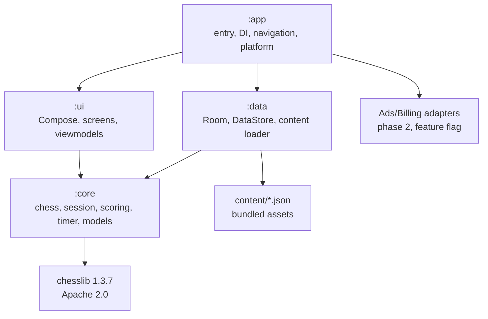

# Архитектура Chess Problem

**Статус:** реализовано в v0.4.1 · **Версия:** 0.4.1 · **Дата:** 20.11.2026
**Связано:** [DESIGN](../design/DESIGN_V01_MVP.md) · [RULES](RULES.md) · [ADR](adr/README.md)

Документ описывает реализованную архитектуру Android-приложения и границы
следующих этапов. `core`, `data`, `ui`, `app` и `build-logic` собираются;
360 production-задач (12 глав на уровень, `contentVersion 2026.10.4`) проходят
путь от `content/puzzles` через generated assets до Canvas-доски и
Room-прогресса. В v0.4.0 добавлены тип `DRAW`, drag-and-drop и
TalkBack-семантика клеток.

---

## 1. Принципы

1. **Правила — в `core`, UI — в `ui`.** Шахматная логика, сессия, таймер и
   звёзды не зависят от Android и Compose.
2. **Офлайн-first.** Контент в assets, прогресс в Room/DataStore, никаких
   сетевых вызовов в v1.0.0.
3. **Однонаправленный поток.** UI отправляет события, `PuzzleSession`/ViewModel
   возвращает неизменяемое состояние.
4. **Доска — кастомный Canvas.** Никаких сторонних board-библиотек: контроль
   над доступностью, анимациями и производительностью.
5. **Никакого движка.** Подсказки и решения — из проверенного контента; для
   матов принимаются альтернативные маты. Это дешевле, быстрее и честнее.
6. **Монетизация — адаптер.** Реклама и покупки не проникают в `core` и `ui`
   напрямую; на старте их нет.

---

## 2. Карта модулей



| Модуль | Содержит | Зависимости |
| --- | --- | --- |
| `:app` | `MainActivity`, `Application`, `AppContainer`, навигация, locale, ads/billing adapters | `:ui`, `:data`, `:core` |
| `:ui` | Compose theme, components, board, screens, ViewModels | `:core` |
| `:data` | Room, DataStore, JSON loader, repository implementations | `:core` |
| `:core` | модели, chesslib wrapper, `PuzzleSession`, scoring, timer, repository interfaces | Kotlin, chesslib |
| `build-logic` | convention plugins: Android app, Android library, Compose | Gradle, AGP, KGP |

**Правила зависимостей:**

- `:core` не импортирует `android.*`, `androidx.*`, `com.iilmchat.chessproblem.ui.*`.
- `:ui` не импортирует `:data`; получает репозитории через интерфейсы `:core`.
- `:data` не импортирует `:ui`.
- `:app` — единственное место, где собираются реализации и интерфейсы.
- `:core` может зависеть от chesslib (JVM), но не от Android.

---

## 3. Структура пакетов

```text
com.iilmchat.chessproblem
├── app/
│   ├── ChessProblemApp.kt
│   ├── MainActivity.kt
│   ├── AppContainer.kt
│   ├── navigation/
│   │   ├── AppNavHost.kt
│   │   └── Routes.kt
│   └── platform/
│       ├── locale/LocaleController.kt
│       ├── ads/AdGateway.kt          ← phase 2
│       └── billing/BillingGateway.kt ← phase 2
├── core/
│   ├── chess/
│   │   ├── ChessRules.kt
│   │   ├── ChesslibRules.kt
│   │   ├── UciMove.kt
│   │   └── BoardSnapshot.kt
│   ├── model/
│   │   ├── Puzzle.kt
│   │   ├── PuzzlePack.kt
│   │   ├── Level.kt
│   │   ├── Chapter.kt
│   │   ├── Task.kt
│   │   ├── Hint.kt
│   │   └── Progress.kt
│   ├── session/
│   │   ├── PuzzleSession.kt
│   │   ├── PuzzleState.kt
│   │   ├── PuzzleEvent.kt
│   │   └── SessionResult.kt
│   ├── scoring/
│   │   ├── StarPolicy.kt
│   │   ├── XpPolicy.kt
│   │   └── StreakPolicy.kt
│   ├── timer/
│   │   ├── PuzzleTimer.kt
│   │   └── TimeSource.kt
│   └── repository/
│       ├── PuzzleRepository.kt
│       ├── ProgressRepository.kt
│       └── SettingsRepository.kt
├── data/
│   ├── content/
│   │   ├── AssetPuzzleSource.kt
│   │   ├── PuzzlePackJson.kt
│   │   └── ContentValidator.kt
│   ├── local/
│   │   ├── ChessDatabase.kt
│   │   ├── entity/
│   │   ├── dao/
│   │   └── settings/SettingsDataStore.kt
│   └── repository/
│       ├── DefaultPuzzleRepository.kt
│       ├── DefaultProgressRepository.kt
│       └── DefaultSettingsRepository.kt
└── ui/
    ├── theme/
    │   ├── Color.kt
    │   ├── Type.kt
    │   ├── Shape.kt
    │   └── ChessProblemTheme.kt
    ├── components/
    │   ├── board/ChessBoard.kt
    │   ├── board/PieceLayer.kt
    │   ├── TimerPill.kt
    │   ├── TaskCard.kt
    │   ├── StarRow.kt
    │   ├── LevelCard.kt
    │   └── ...
    ├── screens/
    │   ├── home/
    │   ├── level/
    │   ├── puzzle/
    │   ├── result/
    │   ├── hints/
    │   ├── progress/
    │   ├── settings/
    │   └── about/
    └── viewmodel/
        ├── HomeViewModel.kt
        ├── PuzzleViewModel.kt
        └── ProgressViewModel.kt
```

---

## 4. Шахматное ядро

### 4.1. Библиотека

Используем **chesslib 1.3.7** (Apache 2.0, JitPack): FEN, SAN, легальные ходы,
мат, пат, рокировка, превращение, взятие на проходе. Своё ядро не пишем:
ошибка в генераторе ходов — критический баг, а библиотека проверена perft-тестами.

Обёртка `ChessRules`:

```kotlin
interface ChessRules {
    fun load(fen: String): BoardSnapshot
    fun legalMoves(board: BoardSnapshot, from: Square): List<Move>
    fun move(board: BoardSnapshot, move: Move): MoveResult
    fun toSan(board: BoardSnapshot, move: Move): String
    fun isCheckmate(board: BoardSnapshot): Boolean
    fun isStalemate(board: BoardSnapshot): Boolean
    fun isDraw(board: BoardSnapshot): Boolean
}
```

`BoardSnapshot` — неизменяемая модель: 64 клетки, сторона хода, права
рокировки, поле en passant, счётчики. UI не работает с `chesslib.Board`
напрямую: только через снимки, чтобы Compose видел изменения.

### 4.2. Perft

Обязательные тесты:

- стартовая позиция, depth 1–5;
- Kiwipete, depth 1–4;
- позиции 3–6 из стандартного набора;
- рокировка, en passant, превращение, мат/пат.

Если perft не совпадает — релиз блокируется.

---

## 5. Сессия задачи

### 5.1. Состояние

```kotlin
data class PuzzleState(
    val puzzleId: String,
    val board: BoardSnapshot,
    val status: Status,
    val moves: List<PlayedMove>,
    val attemptsLeft: Int,
    val hintsUsed: Set<HintTier>,
    val elapsedMs: Long,
    val timeLimitMs: Long,
    val stars: Int?,
    val starsCap: Int,
    val solutionIndex: Int,
    val feedback: Feedback?,
) {
    enum class Status { LOADING, READY, SOLVING, OPPONENT, SOLVED, FAILED, REVIEW }
}
```

`PlayedMove` хранит `uci`, `san`, `byUser`, `isCorrect`, `timestamp`.

### 5.2. События

```kotlin
sealed interface PuzzleEvent {
    data class SelectSquare(val square: Square)
    data class MakeMove(val from: Square, val to: Square, val promotion: PieceType?)
    data object Tick
    data class UseHint(val tier: HintTier)
    data object Pause
    data object Resume
    data object ContinueWithTime
    data object Retry
    data object Reveal
    data object FlipBoard
}
```

### 5.3. Машина состояний

```text
LOADING → READY → SOLVING ⇄ OPPONENT
                    │           │
                    │           └──(ответ применён)──> SOLVING
                    ├──(ошибка, attempts > 0)──> SOLVING (revert)
                    ├──(ошибка, attempts = 0)──> FAILED
                    ├──(время 0)──> FAILED
                    └──(мат/цель)──> SOLVED → REVIEW
FAILED → CONTINUE (SOLVING, +60s, 1 attempt) | RETRY (READY) | REVEAL (REVIEW)
```

### 5.4. Проверка хода

1. `ChessRules.legalMoves` — ход легален?
2. Если `task.type == MATE` и ход ставит мат — принять, даже если он не в линии.
3. Для `task.type == DRAW` успех — завершение проверенной линии; последний ход
   может принадлежать сопернику (пат-этюд), поэтому длина `solution` бывает
   чётной.
4. Иначе сравнить UCI с `solution[solutionIndex]`.
5. Если совпал:
   - применить ход, добавить в историю;
   - если это последний ход — `SOLVED`;
   - иначе `OPPONENT`, применить ответ из `solution[solutionIndex + 1]`,
     вернуться в `SOLVING`.
6. Если не совпал:
   - вернуть снимок до хода;
   - `attemptsLeft--`;
   - `feedback = WrongMove`;
   - если 0 — `FAILED`.

### 5.5. Таймер

`PuzzleTimer` — чистый Kotlin:

```kotlin
class PuzzleTimer(
    private val timeSource: TimeSource,
    private val limitMs: Long,
) {
    fun start()
    fun pause()
    fun resume()
    fun elapsedMs(): Long
    fun remainingMs(): Long
    fun isExpired(): Boolean
}
```

- `PuzzleViewModel` вызывает `tick()` раз в 250 мс; таймер не создаёт
  собственный поток.
- Пауза на lifecycle, hint sheet, pause/exit dialog; при возврате из фона
  показывается overlay «Пауза».
- При выходе/уходе в фон в Room (`puzzle_progress.lastPlayedAt`) сохраняются
  данные для карточки «Продолжить».
- Активная сессия дополнительно сохраняется как `PuzzleSessionSnapshot` в
  `SavedStateHandle`: `solutionIndex`, сыгранные ходы, `attemptsLeft`,
  `mistakes`, подсказки, `remainingMs`, `continued` и ориентация доски. После
  process death сессия восстанавливается **на паузе** и показывает overlay
  «Пауза» — время не тикает до явного Resume. Снимок живёт в state процесса
  и не уходит с устройства
  ([PRIVACY POLICY §2.2](../legal/PRIVACY_POLICY.md#22-какие-данные-обрабатываются)).
  JVM-тесты восстановления — в `:core`/`:ui`; instrumented-прогон — KI-014.

---

## 6. Данные

### 6.1. Контент

- JSON-паки в assets: Gradle-задача `syncPuzzlePacks` в `data/build.gradle.kts`
  копирует `content/puzzles/*.json` в генерируемый каталог
  `data/build/generated/puzzlePacks/content/` перед каждой сборкой.
- Загрузка через `kotlinx.serialization`; валидация в debug и CI.
- `PuzzleRepository` отдаёт `Flow<List<Puzzle>>` по уровню/главе; кэш в памяти.
- `contentVersion` (`2026.10.4`) читается из заголовков паков через
  `ContentVersionProvider` и показывается в «О приложении».
- При обновлении пака несовместимые записи прогресса (в том числе демо v0.2.0 с
  пустой версией) удаляются при инициализации репозитория (ADR-0009, KI-018).

### 6.2. Room

```text
puzzle_progress(
  puzzleId TEXT PRIMARY KEY,
  solved INTEGER NOT NULL,
  reviewed INTEGER NOT NULL,
  stars INTEGER NOT NULL,
  bestTimeMs INTEGER,
  attempts INTEGER NOT NULL,
  hintsUsed INTEGER NOT NULL,
  lastPlayedAt INTEGER NOT NULL,
  chapterId TEXT NOT NULL DEFAULT '',
  contentVersion TEXT NOT NULL DEFAULT ''
)

chapter_progress(
  chapterId TEXT PRIMARY KEY,
  solvedCount INTEGER NOT NULL,
  stars INTEGER NOT NULL,
  completedAt INTEGER
)

daily_streak(
  date TEXT PRIMARY KEY,      -- ISO local date
  solvedCount INTEGER NOT NULL
)

achievement(
  id TEXT PRIMARY KEY,
  unlockedAt INTEGER
)
```

- Схема Room — версия 2; `Migration_1_2` добавляет `chapterId`/`contentVersion`
  и создаёт `chapter_progress` (ADR-0009).
- `puzzle_progress` — единственный источник звёзд; записи с неактуальной
  `contentVersion` удаляются при инициализации репозитория.
- `chapter_progress` — денормализованный кэш для быстрых списков; очищается и
  пересчитывается из `puzzle_progress` целиком после очистки и при каждом
  `save()`.
- `daily_streak` — для серии и задачи дня.
- Индексы: `puzzleId`, `chapterId`, `date`.

### 6.3. DataStore

Ключи:

- `language`: `system|ru|en` (legacy-ключ; рабочее значение — `LocalePreferences`)
- `theme`: `system|dark|light` (legacy-ключ для сидинга; рабочее — `ThemePreferences`)
- `boardTheme`: `sage|classic|slate|high_contrast`
- `coordinates`: Boolean
- `autoFlip`: Boolean
- `colorblind`: Boolean
- `reduceMotion`: Boolean
- `sound`: Boolean
- `haptics`: Boolean
- `timerSound`: Boolean
- `onboardingSeen`: Boolean
- `dailyReminder`: Boolean (v0.4.0)

Карточка «Продолжить» строится по `puzzle_progress.lastPlayedAt` в Room, а не
по DataStore. Остаток таймера активной сессии хранится в `SavedStateHandle`,
а не в DataStore/Room (§5.5). Перед первым composable
`theme` и `language` читаются синхронно из `ThemePreferences` /
`LocalePreferences` (SharedPreferences) как зеркала DataStore — ADR-0010,
KI-015.

### 6.4. Backup

`android:allowBackup="false"` в v1.0.0: прогресс не уходит в облако. Это
согласуется с политикой «данные остаются на устройстве». Если появится
облачная синхронизация — отдельное решение и политика.

---

## 7. UI-слой

### 7.1. Compose

- Material 3, кастомная тема из `design/tokens.json`.
- Навигация — Navigation Compose с type-safe routes (kotlinx.serialization).
- ViewModel на экран; `StateFlow<PuzzleState>`; события — методы.
- Никакой бизнес-логики в composables: только отображение и вызов событий.
- `collectAsStateWithLifecycle()` для состояния.
- Иммутабельные UI-модели; стабильные ключи в списках.

### 7.2. Доска

- `ChessBoard` — `Canvas` + `Layout` для фигур.
- Клетки — 8×8; координаты — `drawText` с `TextMeasurer`.
- Фигуры — `ImageVector`/`Path` из собственного набора; кэш `ImageBitmap`.
- Анимация хода — `Animatable<Offset>` 180 мс; при `reduceMotion` — 0.
- Слои: поля → подсветки → фигуры → стрелки/точки → координаты.
- Семантика: `Modifier.semantics` на каждую клетку; действия «Выбрать»,
  «Ход», «Отменить выбор».
- Drag: `pointerInput` + `detectDragGestures`; tap: `detectTapGestures`.
- Планшет: центрированная колонка max 560 dp, поля 32 dp на ≥600 dp (допуск
  спецификации до 640 dp); runtime-проверка на 7–10" — KI-010/KI-012.
- Никаких аллокаций в `draw`; пути и кисти — кэш.

### 7.3. Состояния экранов

| Экран | ViewModel | Состояние |
| --- | --- | --- |
| Home | `HomeViewModel` | daily, continue, levels, streak, loading/error |
| Level | `LevelViewModel` | chapters, progress, recommended |
| Puzzle | `PuzzleViewModel` | `PuzzleState` + hints + timer |
| Result | `ResultViewModel` | stars, explanation, next |
| Progress | `ProgressViewModel` | stats, achievements |
| Settings | `SettingsViewModel` | settings, language, reset |

### 7.4. Навигация

```text
home
level/{level}
chapter/{chapterId}
puzzle/{puzzleId}
result/{puzzleId}
progress
settings
about
```

- `puzzle` — full screen, bottom nav hidden.
- `result` — full screen или sheet; в v0.2.0 — full screen.
- Back stack: home → level → chapter → puzzle → result.
- Deep links не нужны.

---

## 8. DI и сборка

### 8.1. Ручной DI

`:app` создаёт `AppContainer`:

```kotlin
class AppContainer(context: Context) {
    val database by lazy { ChessDatabase.create(context) }
    val settings by lazy { SettingsDataStore(context) }
    val puzzleRepository: PuzzleRepository by lazy {
        DefaultPuzzleRepository(AssetPuzzleSource(context.assets))
    }
    val progressRepository: ProgressRepository by lazy {
        DefaultProgressRepository(database.puzzleProgressDao())
    }
}
```

- ViewModel factories получают зависимости из `AppContainer`.
- Никакого Hilt/Koin в MVP: меньше kapt/KSP, быстрее сборка, проще тесты.
- Если модулей станет больше 8 или DI-граф вырастет — пересмотреть (ADR-0007).

### 8.2. Gradle

- Gradle 9.8.2, AGP 9.4.1 (built-in Kotlin 2.2.10), JDK 21, target 17.
- `compileSdk = 37` (Compose 1.12.1 / AndroidX 2026.09), `targetSdk = 36`,
  `minSdk = 26`.
- `gradle/libs.versions.toml` — единственный источник версий.
- `build-logic` — convention plugins:
  - `chessproblem.android.application` — compileSdk, min/target, packaging;
  - `chessproblem.android.library` — то же для библиотек;
  - `chessproblem.android.compose` — compose compiler plugin.
- `org.gradle.caching=true`, `org.gradle.configuration-cache=true`.
- KSP 2.2.10-2.0.2 для Room; `android.disallowKotlinSourceSets=false` —
  вынужденный обход до миграции KSP на built-in Kotlin source sets.
- Compose BOM 2026.09.00, Room 2.8.5, DataStore 1.3.0,
  Navigation 2.10.2, Lifecycle 2.11.0.
- R8 + shrinkResources в release.
- Подпись — из `keystore.properties` (не коммитится).

---

## 9. Тестирование

| Уровень | Что | Где | Статус |
| --- | --- | --- | --- |
| Unit | FEN, SAN, легальные ходы, мат, превращение | `core/src/test` | 21 тест, зелёный |
| Unit | сессия: ошибки, continue, таймаут, подсказки, ответ соперника | `core/src/test` | зелёный |
| Unit | звёзды, XP, формула таймера | `core/src/test` | зелёный |
| Unit | JSON-парсинг, Room DAO, репозитории | `data/src/test` | план |
| UI | выбор фигуры, ход, подсказка, результат, смена языка | `ui/src/androidTest` | план (KI-014) |
| Screenshot | главная, решатель, результат, подсказки | `ui/src/test` | план (KI-014) |
| Content | 360 задач: схема, легальность, `DRAW`, дубли, RU/EN | `tools/validate-content.mjs` | зелёный: 0 error / 42 WARN |
| Manual | устройства, lifecycle, TalkBack, таймер | [QA guide](../qa/MANUAL_TESTING_GUIDE.md) | частично: Pixel 6 API 36 |

**Проверенные тесты сессии:**

- неверный ход возвращает позицию и уменьшает попытки;
- третий неверный ход → FAILED;
- правильный ход применяет ответ соперника;
- последний ход → SOLVED, звёзды по политике;
- таймаут → FAILED, continue даёт +60 с и 1 попытку;
- альтернативный мат принимается.

**Проверенные тесты:** восстановление сессии после process death в `:core`/`:ui`,
Room DAO на in-memory базе, Compose UI-тесты JVM.

**Следующие тесты:** instrumented-прогон process death/restore на устройстве и
screenshot tests (KI-014).

---

## 10. Производительность

| Метрика | Цель | Как проверяем |
| --- | --- | --- |
| Холодный старт | < 2 с | Macrobenchmark |
| FPS | 60 | Macrobenchmark/JankStats |
| Память | < 150 МБ | Android Studio Profiler |
| APK | < 20 МБ | CI artifact size |
| Размер контента | < 2 МБ | JSON + сжатие |
| Батарея | без фоновой работы | ручной тест |

- Синхронный кэш `theme`/`language` для холодного старта — ADR-0010 (KI-015).
- Baseline Profile для главной и решателя (после замеров на устройстве).
- Никаких сетевых SDK в v1.0.0.
- Шрифты — subset, только нужные глифы.
- Фигуры — векторы, не PNG.
- Контент — JSON, сжатый в APK.

---

## 11. Безопасность и приватность

- Нет `INTERNET` в v1.0.0.
- Нет WebView, нет динамического кода.
- `android:exported=false` для всех компонентов, кроме launcher.
- `allowBackup=false`.
- Нет логирования PII; в debug — только ID задач.
- Keystore — вне репозитория, backup в менеджере паролей.
- R8 в release; mapping сохраняется для crash-репортов.
- При добавлении рекламы/покупок — отдельный аудит разрешений, политики и
  декларации RuStore.

---

## 12. Точки расширения

| Что добавляем | Где правится |
| --- | --- |
| Новый уровень | `Level` enum, контент-пак, главы, store-описание |
| Новый пак задач | `content/puzzles/*.json`, `contentVersion`, CI |
| Версионирование контента | `contentVersion`, изоляция демо-прогресса, ADR-0009 |
| Холодный старт | `startup_prefs` как зеркало `theme`/`language`, ADR-0010 |
| Новая тема | `themes` в контенте, статистика, фильтры |
| Новая подсказка | `HintTier`, `HintPolicy`, UI-лист |
| Новый язык | `values-xx`, localized content, QA |
| Реклама | `AdGateway` в `:app`, feature flag, политика |
| Покупки | `BillingGateway` в `:app`, Premium UI, RuStore SDK |
| Облако | `ProgressRepository` remote, аккаунт, политика |
| iOS | общий `core`, KMP-исследование (не в v1.x) |

---

## 13. Открытые технические вопросы

1. **JitPack и chesslib.** Если JitPack недоступен — вендорим исходники
   Apache 2.0 в `third_party/chesslib` и собираем локально.
2. **Paparazzi vs Roborazzi.** Выбрать перед screenshot-тестами (KI-014).
3. **Room и KSP.** Решено: Room 2.8.5 + KSP 2.2.10-2.0.2; нужен
   `android.disallowKotlinSourceSets=false`, пока KSP не мигрирует.
4. **Compose BOM.** Зафиксирован: 2026.09.00; compileSdk 37.
5. **Baseline Profile.** Отложен до замеров на реальном устройстве; здоровье
   холодного старта обеспечивает синхронный кэш настроек (ADR-0010, KI-015).
6. **Планшет.** Центрированная колонка max 560 dp (допуск до 640 dp); двухпанельная
   раскладка — исследование v0.5.0; аппаратная проверка — KI-010/KI-012.
7. **Локальные напоминания.** `POST_NOTIFICATIONS` и политика — только если
   реально нужно.
