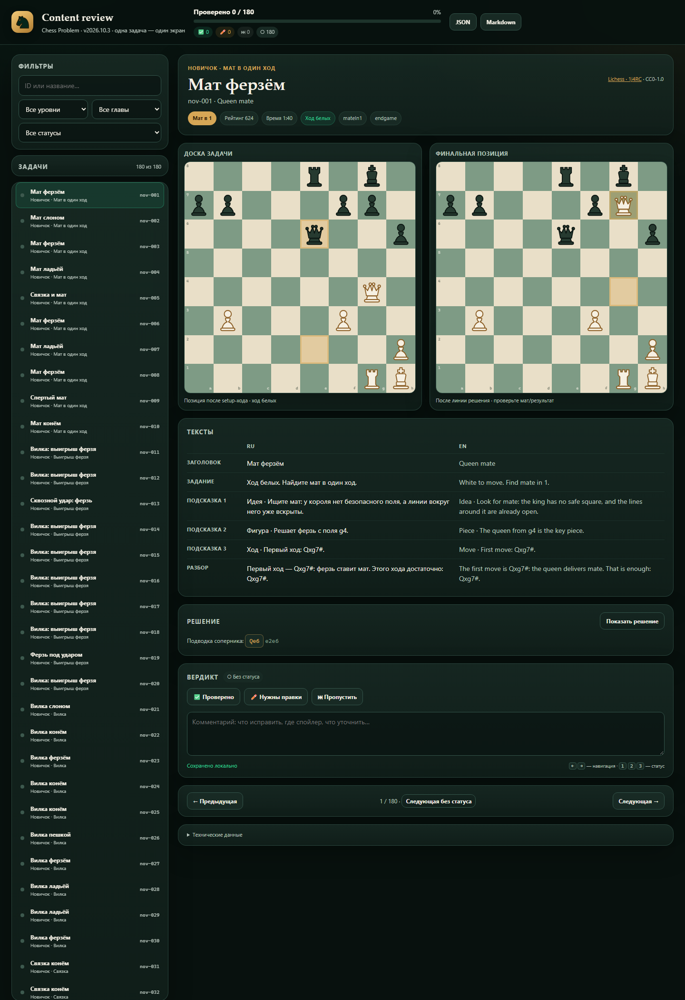

# Content review

Локальный ревьюер шахматного контента: одна задача — один экран, две доски,
RU/EN тексты, линия решения, статусы и экспорт замечаний.



## Запуск

```bash
node tools/review/build-review.mjs
```

Откройте `tools/review/index.html` двойным кликом. Данные встроены в HTML,
`fetch()` и локальный сервер не нужны.

Генератор читает `content/puzzles/*.json`, применяет `setupMove` и линию
решения через `chess.js`, считает SAN и финальный FEN, затем встраивает всё в
`index.html`.

## Что внутри

- две доски: позиция после setup-хода и финальная позиция;
- задание, рейтинг, время, source, темы;
- тексты RU/EN: title, prompt, hints 1–3, explanation;
- линия решения SAN с кнопкой «Показать/скрыть»;
- статусы **✅ Проверено / ✏️ Нужны правки / ⏭ Пропущено**;
- комментарий к задаче;
- фильтры по уровню, главе, статусу и поиск по ID/названию;
- прогресс `проверено N / M`;
- экспорт `review-notes.json` и `review-notes.md`.

## Заметки

Статусы и комментарии хранятся в `localStorage` браузера под ключом
`chessProblem.review.notes.<contentVersion>`. Перезагрузка страницы их не
теряет; при смене `contentVersion` начинается новый набор заметок, чтобы
старые замечания не применились к другим задачам.

`content/puzzles/*.json` ревьюер только читает. Изменения в контент вносятся
отдельным патчем после ревью.

## Экспорт

`review-notes.json`:

```json
{
  "contentVersion": "2026.10.3",
  "summary": { "total": 180, "reviewed": 1, "ok": 0, "fix": 1, "skip": 0, "unreviewed": 179 },
  "notes": [
    {
      "puzzleId": "nov-001",
      "status": "fix",
      "comment": "Проверить заголовок на спойлер.",
      "updatedAt": "2026-10-29T..."
    }
  ]
}
```

Markdown — таблица всех 180 задач со статусом и комментарием.

Кнопка **Импорт** загружает ранее сохранённый `review-notes.json` (или
совместимый черновик) и переносит статусы/комментарии в текущую сессию.
Записи с неизвестными ID или пустые заметки пропускаются; версия контента
показывается в тосте, но импорт не блокирует.

Черновик v0.4.0: `tools/review/drafts/v0.4.0-review-draft.json` — 140
WIN/MATE предварительно отмечены `ok`, 40 DRAW были оставлены на подтверждение.
Итог человеческого ревью: `docs/reviews/v0.4.0-review-notes.json` —
180/180 `ok`, ошибок и замечаний нет.

## Горячие клавиши

- `←` / `→` или `j` / `k` — предыдущая/следующая задача;
- `1` / `2` / `3` — OK / нужны правки / пропустить;
- `s` — показать/скрыть линию решения.

## Ограничения

- Ревьюер не проверяет альтернативные решения и не запускает движок; он
  показывает подготовленную линию и позиции для человеческой проверки.
- Для `fix` комментарий не обязателен технически, но именно он делает экспорт
  полезным для правок.
- `index.html` генерируется; после изменения `content/puzzles` или
  `template.html` запустите `build-review.mjs` заново.
